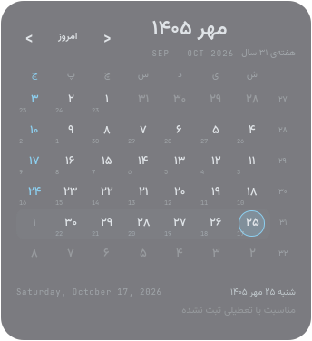

# Jalali Desktop Calendar

A Ryoku desktop-widget plugin (`jalali-desktop-calendar`): a right-to-left
Jalali (Solar Hijri) month calendar that sits on the wallpaper, styled after
Ryoku's built-in desktop calendar.



For the QS Bar companion (today's date on the bar, with a month panel), see
[ryoku-jalali-calendar](https://github.com/Geeknux/ryoku-jalali-calendar).

## What it does

- Month title (`مهر ۱۴۰۵`) with the week of the Jalali year and the Gregorian
  months it spans.
- `›` previous month, `امروز` back to today, `‹` next month.
- A Saturday-first, six-week grid. Days from the neighbouring months are
  ghosted, the current week is banded, and today is ringed in the accent colour.
  Fridays and official holidays are tinted.
- Each cell shows a small Gregorian day number; a week-number column runs down
  the right.
- The footer names the hovered or selected day in Jalali and Gregorian, and
  shows its holiday if it has one. Clicking a ghosted day jumps to its month.

Holidays are Iran's official holidays that fall on a **fixed** Solar Hijri
date (Nowruz, 12 and 13 Farvardin, 14 and 15 Khordad, 22 Bahman, 29 Esfand).
Holidays set by the lunar Hijri calendar move every year and depend on moon
sighting, so they are not included.

The host draws the glass or card backing and handles moving, resizing,
opacity and the right-click menu, just as it does for built-in widgets. The
widget follows the palette accent, or a colour pinned from that menu.

## What it reads and writes

It reads only the system clock. It runs no external commands, contacts no
network host, needs no privileges, and writes no files.

Text is set in the Vazirmatn font; if it is missing, fontconfig falls back to
any installed Persian font.

## Settings

All toggles, on by default, set from the widget's right-click menu.

| key             | description                                |
| --------------- | ------------------------------------------ |
| persianDigits   | Persian (۱۲۳) or Latin (123) digits        |
| showWeekNumbers | The week-of-year column                    |
| showGregorian   | Gregorian day numbers, span and date line  |
| showHolidays    | Tint and name the fixed official holidays  |

## Install

Requires a [Ryoku](https://ryoku.dev) desktop.

```
ryoku plugin add https://github.com/Geeknux/ryoku-jalali-desktop-calendar --yes
```

Or from a local clone:

```
git clone https://github.com/Geeknux/ryoku-jalali-desktop-calendar
ryoku plugin validate ryoku-jalali-desktop-calendar
ryoku plugin add ryoku-jalali-desktop-calendar --yes
```

Remove it with `ryoku plugin remove jalali-desktop-calendar`.

## Author

Amir M. Mahmoudi <mahmoudi.amirmahmoud@gmail.com>, [@Geeknux](https://github.com/Geeknux).
This plugin is community-made (`official` is false); MIT licensed.
